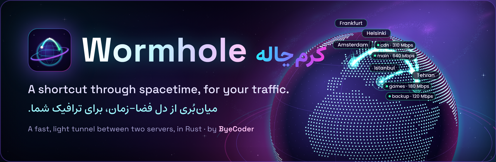
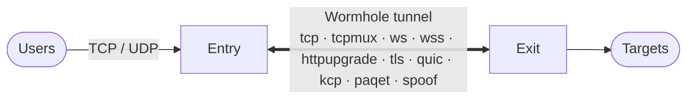
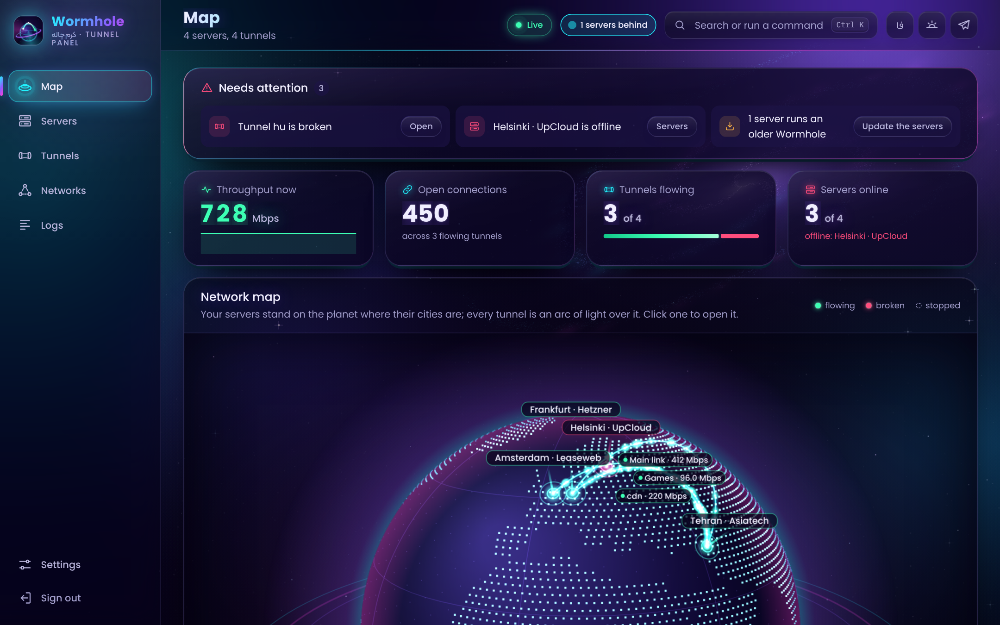
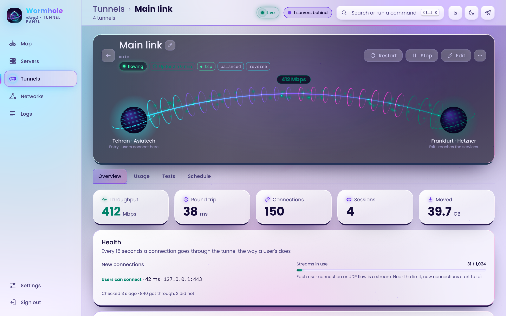
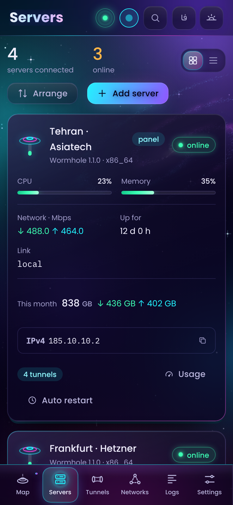

<p align="center">
  
</p>

<p align="center">
  <a href="https://github.com/ByeCoder/Wormhole/actions/workflows/ci.yml"></a>
  <a href="https://github.com/ByeCoder/Wormhole/releases"></a>
  
  
  <a href="LICENSE"></a>
</p>

<p align="center">
  <b>English</b> · <a href="README_FA.md">فارسی</a> ·
  <a href="https://byecoder.github.io/Wormhole/">Website</a> ·
  <a href="https://byecoder.github.io/Wormhole/docs/">Docs</a> ·
  <a href="https://byecoder.github.io/Wormhole/try/">Live demo</a> ·
  <a href="CHANGELOG.md">Changelog</a>
</p>

---

## So, what is it? 🌌

In physics, a wormhole is a shortcut: spacetime folds over so two faraway points touch, and whatever goes in one end pops straight out the other.

Wormhole does exactly that for your traffic. It links two servers with a fast, encrypted tunnel:

- your users connect to the **entry** server,
- Wormhole carries their TCP and UDP traffic across,
- and the **exit** server hands it to wherever it was going.

It's one small Rust program (around 8 MiB of RAM per side, no garbage collector) plus a good-looking web panel, so you run the whole thing from your browser.



<p align="center">
  
</p>

<table align="center">
  <tr>
    <td align="center" width="62%"></td>
    <td align="center" width="26%"></td>
  </tr>
</table>

## Install ⚡

On the server that'll run the panel, as root:

```bash
bash <(curl -fsSL https://raw.githubusercontent.com/ByeCoder/Wormhole/main/scripts/wormhole.sh)
```

The script figures out your CPU (x86_64, aarch64 or armv7), grabs the latest release, checks its signature and opens a menu. Pick **Install the web panel here** and it prints the panel's address and a one-time login link.

From there, everything's in the browser:

1. add your other servers (one command on each, with a code the panel gives you),
2. use the wizard to make a tunnel between any two of them,
3. done! 🎉

Want to poke around first? The [live demo](https://byecoder.github.io/Wormhole/try/) runs the real panel on sample data.

## New in 1.1.0 ✨

- **The panel lives in space now.** Everything floats in a living galaxy. The map is a **3D neon planet**: your servers stand in their own cities, and every tunnel is an arc of light from one side of the world to the other. When a tunnel comes up, its light shoots across like a beam. Drag the planet to spin it!
- **Every tunnel's page is an actual wormhole** between two little worlds, with its traffic swirling through as light.
- **Two new ways to run `ws` and `wss`:**
  - `httpupgrade`: a CDN still sees a WebSocket, but after the handshake the bytes go unframed and unmasked, so there's less CPU work and less overhead.
  - `tls`: plain TLS with the tunnel right inside, no HTTP at all. The lightest way to pass as an ordinary HTTPS site (direct routes only, not behind a CDN).
- **Lighter:** the panel is 16 % smaller, and animations pause themselves when you can't see them.

## What you get 🚀

- **Lots of ways through.** `tcp`, `tcpmux`, `ws` and `wss` (for CDNs, or whenever you need to look like HTTPS; now also as [`httpupgrade`](docs/transports.md#httpupgrade-and-plain-tls) and plain `tls`). Then `quic` and `kcp` over UDP for long or lossy routes, and [`paqet`](docs/paqet.md): KCP hidden in raw TCP segments, for networks that block UDP but let TCP through. `quic` can be sealed packet by packet so it stops looking like QUIC. [`spoof`](docs/transports.md) goes one step further and forges the source address, for Layer-3 whitelist firewalls. Can't be bothered to choose? `auto` finds one that works.
- **Either direction.** The exit can call the entry (`reverse`) or the other way round (`direct`), and it reconnects on its own if the link drops.
- **TCP and UDP.** WireGuard, DNS and games all go through. On `kcp`, `paqet` and `quic` one lost packet doesn't hold up everything else, and games get FEC and optional packet duplication.
- **A panel that cleans up after itself.** The wizard checks both servers before it builds anything, and if something breaks halfway it puts both back the way they were. The map, charts, logs, speed test, backups, private GRE/VXLAN networks and updates all live in the same place.
- **Real usage numbers.** Every tunnel and server shows what it used today, this week, this month and all time (Solar Hijri or Gregorian calendar). The numbers come from the kernel's own counters, overhead and resends included. Give a server a monthly quota and it warns you before you hit it.
- **Telegram alerts.** Your own bot pings you when a server goes offline or a tunnel drops (and when it's back), and answers `/status` with the state of everything. If Telegram is blocked, it goes through a proxy or a tunnel. [Set it up](https://byecoder.github.io/Wormhole/docs/telegram/).
- **Signed releases.** The install script, the panel and its agents all check a release's signature before running anything from it.

## Docs 📚

Everything else is on the website, in English and Persian:

| | |
|---|---|
| [Getting started](https://byecoder.github.io/Wormhole/docs/getting-started/) | install, your first tunnel, systemd |
| [Using the panel](https://byecoder.github.io/Wormhole/docs/using-the-panel/) · [Guided tour](https://byecoder.github.io/Wormhole/docs/tour/) · [Video](https://byecoder.github.io/Wormhole/docs/video/) | the panel, page by page |
| [The manager script](https://byecoder.github.io/Wormhole/docs/manager/) | installing, updating, the menu |
| [Transports](https://byecoder.github.io/Wormhole/docs/transports/) · [Which one?](https://byecoder.github.io/Wormhole/docs/how-it-works/) · [Paqet](https://byecoder.github.io/Wormhole/docs/paqet/) | picking and tuning |
| [Configuration reference](https://byecoder.github.io/Wormhole/docs/configuration/) | every setting, with defaults and limits |
| [UDP and games](https://byecoder.github.io/Wormhole/docs/udp-and-games/) · [CDN](https://byecoder.github.io/Wormhole/docs/cdn/) | specific setups |
| [Troubleshooting](https://byecoder.github.io/Wormhole/docs/troubleshooting/) · [Security](https://byecoder.github.io/Wormhole/docs/security/) | when something's off |
| [Changelog](CHANGELOG.md) | what changed in each version |

The same pages are plain Markdown in [`docs/`](docs/README.md) (Persian: [`docs/fa/`](docs/fa/README.md)).

## Build it yourself 🛠️

```bash
cargo build --release                         # target/release/wormhole
cargo test                                    # the nginx tests run too if nginx is installed
cargo build --release --no-default-features   # without quic and kcp
```

The panel's web app is in `panel/web` (`npm ci && npm run build`), and the website is in `site/`. The design and the protocol are written up in [docs/ROADMAP.md](docs/ROADMAP.md).

## Support 💜

Wormhole is built by one person and it's free to run on your own servers. If it's useful to you and you'd like to keep it going, you can donate, but it's never required.

One thing to watch: send each coin **only on the network listed next to it**. Coins sent on the wrong network are gone for good. (This is on the website too, in [English](docs/support.md) and [Persian](docs/fa/support.md).)

| Coin | Network | Address |
|---|---|---|
| USDT | TRON (TRC20) | `TKM87mEXhUpEBzqvNxs1qjM4EddX6VMXmw` |
| Gram | TON | `UQDfjT-h4ENIrt_Sq5-zBy9TvhckniwSLCkS7zIVX4fVSaFw` |
| Bitcoin (BTC) | Bitcoin | `bc1qc4cgy5etuwj2375c5zqma7xmjtk59s5s49rfp5` |

A ⭐ on the repo, a bug report with its log, or telling a friend who runs servers helps just as much.

## License

Wormhole is released under the [MIT license](LICENSE): use it, change it, share it; just keep the copyright and license text.

<p align="center"><sub>Made with 💜 by <a href="https://github.com/ByeCoder">ByeCoder</a></sub></p>
