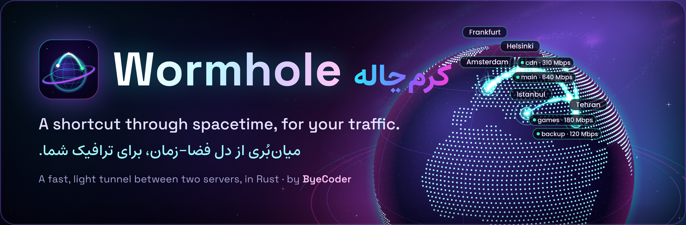
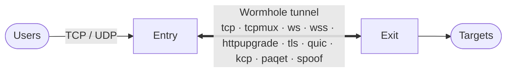
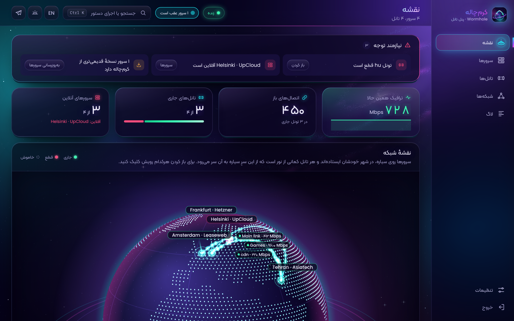
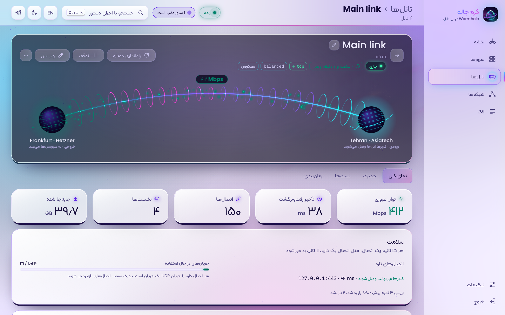
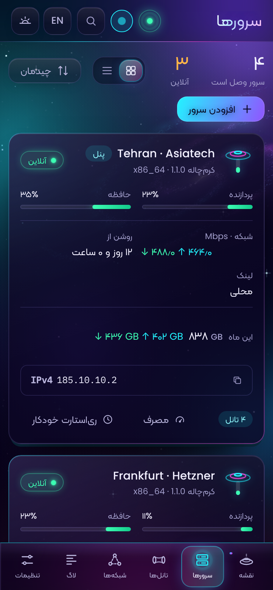

<p align="center">
  
</p>

<p align="center">
  <a href="https://github.com/ByeCoder/Wormhole/actions/workflows/ci.yml"></a>
  <a href="https://github.com/ByeCoder/Wormhole/releases"></a>
  
  
  <a href="LICENSE"></a>
</p>

<p align="center">
  <a href="README.md">English</a> · <b>فارسی</b> ·
  <a href="https://byecoder.github.io/Wormhole/fa/">وب‌سایت</a> ·
  <a href="https://byecoder.github.io/Wormhole/fa/docs/">مستندات</a> ·
  <a href="https://byecoder.github.io/Wormhole/fa/try/">دموی زنده</a> ·
  <a href="docs/fa/CHANGELOG.md">تغییرات</a>
</p>

---

<div dir="rtl">

## کرم‌چاله چیه؟ 🌌

کرم‌چاله تو فیزیک یه میون‌بُره: دو تا نقطهٔ دور از هم که فضا-زمان رو تا می‌کنه و به هم می‌چسبونه، که هر چی از یه سرش بره تو، درجا از اون سرش بیاد بیرون.

این برنامه هم دقیقاً همین کارو با ترافیکت می‌کنه. دو تا سرور رو با یه تانل سریع و رمزنگاری‌شده به هم وصل می‌کنه:

- کاربرها به سرور **ورودی** (entry) وصل می‌شن،
- کرم‌چاله ترافیک TCP و UDPشونو می‌بره اون‌ور،
- و سرور **خروجی** (exit) می‌رسونتش به مقصد واقعی.

همه‌ش یه برنامهٔ کوچیک Rust‌ه (هر سمت حدود ۸ مگابایت رم، بدون garbage collector) با یه پنل وب خوشگل که همه‌چی رو از تو مرورگر مدیریت می‌کنی.

</div>



<p align="center">
  
</p>

<table align="center">
  <tr>
    <td align="center" width="62%"></td>
    <td align="center" width="26%"></td>
  </tr>
</table>

<div dir="rtl">

## نصب ⚡

رو سروری که می‌خوای پنل روش باشه، با کاربر root اینو بزن:

</div>

```bash
bash <(curl -fsSL https://raw.githubusercontent.com/ByeCoder/Wormhole/main/scripts/wormhole.sh)
```

<div dir="rtl">

اسکریپت خودش CPUتو تشخیص می‌ده (x86_64، aarch64 یا armv7)، آخرین نسخه رو می‌گیره، امضاشو چک می‌کنه و یه منو باز می‌کنه. **Install the web panel here** رو بزن؛ آدرس پنل و یه لینک ورود یه‌بارمصرف بهت می‌ده.

از این به بعد همه‌چی تو مرورگره:

1. سرورهای دیگه‌تو اضافه کن (رو هر کدوم یه دستور با کدی که پنل بهت می‌ده اجرا می‌کنی)،
2. با ویزارد بین هر دو تاشون یه تانل بساز،
3. و تمام! 🎉

اول می‌خوای ببینی چه شکلیه؟ [دموی زنده](https://byecoder.github.io/Wormhole/fa/try/) رو باز کن.

## تو نسخهٔ ۱٫۱٫۰ چی اضافه شد؟ ✨

- **یه ظاهر کاملاً فضایی.** کل پنل وسط یه کهکشان زنده شناوره. نقشه حالا یه **سیارهٔ نئونی سه‌بعدیه** که سرورهات تو شهر خودشون روش وایسادن و هر تانل یه کمان نوره که از این سرِ دنیا می‌ره اون سر. وقتی یه تانل وصل می‌شه، نورش مثل یه پرتو از ورودی شلیک می‌شه تا خروجی. سیاره رو با موس بکش تا بچرخه!
- **صفحهٔ هر تانل** هم یه کرم‌چالهٔ واقعیه بین دو تا سیارهٔ کوچیک، با ذره‌های نور ترافیک که توش می‌چرخن.
- **دو تا راه تازه برای `ws` و `wss`:**
  - `httpupgrade`: برای CDN همون وب‌سوکت به نظر میاد، ولی بعدش بایت‌ها بی‌قاب و بی‌ماسک می‌رن؛ یعنی پردازش و سربار کمتر.
  - `tls`: TLS خالی و تانل مستقیم توش، بدون هیچ HTTP. سبک‌ترین راه برای اینکه شبیه یه سایت HTTPS معمولی باشی (فقط برای مسیر مستقیم، نه پشت CDN).
- **سبک‌تر:** پنل ۱۶٪ کم‌حجم‌تر شده و انیمیشن‌ها وقتی دیده نمی‌شن خودشون متوقف می‌شن.

## چی بهت می‌ده؟ 🚀

- **کلی راه برای رد شدن.** `tcp`، `tcpmux`، `ws` و `wss` (برای CDN و وقتی باید شبیه HTTPS باشی؛ حالا با [`httpupgrade`](docs/fa/transports.md) و `tls` خالی هم)، `quic` و `kcp` روی UDP برای مسیرهای دور و پراتلاف، و [`paqet`](docs/fa/paqet.md): KCP تو دل بسته‌های خام TCP، برای جاهایی که UDP بسته‌ست ولی TCP رد می‌شه. `quic` رو هم می‌شه جوری مهر و موم کرد که دیگه شبیه QUIC نباشه. [`spoof`](docs/fa/transports.md) یه قدم جلوتر می‌ره و آدرس مبدأ رو جعل می‌کنه، برای فایروال‌های لیست‌سفید. حوصلهٔ انتخاب نداری؟ `auto` خودش یکی رو پیدا می‌کنه که کار کنه.
- **از هر دو طرف.** خروجی می‌تونه به ورودی وصل شه (`reverse`) یا برعکس (`direct`)، و اگه قطع شد خودش دوباره وصل می‌شه.
- **هم TCP هم UDP.** WireGuard و DNS و بازی همه ازش رد می‌شن. رو `kcp`، `paqet` و `quic` یه بستهٔ گم‌شده بقیه رو معطل نمی‌کنه، و برای بازی FEC و تکثیر بسته هم داره.
- **پنلی که اشتباهاتشو جمع می‌کنه.** ویزارد قبل از ساختن تانل هر دو سرور رو چک می‌کنه و اگه وسط کار چیزی خراب شد، هر دو رو برمی‌گردونه سر جای اولشون. نقشه، نمودار، لاگ، تست سرعت، بکاپ، شبکهٔ خصوصی GRE و VXLAN و آپدیت هم همه‌شون یه جان.
- **مصرف واقعی.** هر تانل و سرور نشون می‌ده امروز، این هفته، این ماه و کلاً چقدر مصرف کرده (با تقویم شمسی یا میلادی)، از روی شمارنده‌های خود کرنل و با سربار و ارسال‌های دوباره. برای هر سرور سهمیهٔ ماهانه هم می‌تونی بذاری که قبل از تموم شدن خبرت کنه.
- **خبر تو تلگرام.** ربات خودت بهت می‌گه کِی یه سرور آفلاین شد یا یه تانل قطع شد (و کِی برگشت)، و به `/status` با وضعیت همه‌چی جواب می‌ده. اگه تلگرام بسته باشه، از پروکسی یا یه تانل رد می‌شه. [راه‌اندازی](https://byecoder.github.io/Wormhole/fa/docs/telegram/).
- **نسخه‌های امضاشده.** اسکریپت نصب، پنل و agentها قبل از اجرای هر نسخه امضاشو چک می‌کنن.

## مستندات 📚

بقیهٔ چیزا رو سایت هست، فارسی و انگلیسی:

| | |
|---|---|
| [شروع کار](https://byecoder.github.io/Wormhole/fa/docs/getting-started/) | نصب، اولین تانل، systemd |
| [کار با پنل](https://byecoder.github.io/Wormhole/fa/docs/using-the-panel/) · [تور راهنما](https://byecoder.github.io/Wormhole/fa/docs/tour/) · [ویدیوی آموزشی](https://byecoder.github.io/Wormhole/fa/docs/video/) | پنل، صفحه به صفحه |
| [اسکریپت مدیر](https://byecoder.github.io/Wormhole/fa/docs/manager/) | نصب، آپدیت، منو |
| [ترنسپورت‌ها](https://byecoder.github.io/Wormhole/fa/docs/transports/) · [کدوم یکی؟](https://byecoder.github.io/Wormhole/fa/docs/how-it-works/) · [Paqet](https://byecoder.github.io/Wormhole/fa/docs/paqet/) | انتخاب و تنظیم |
| [مرجع تنظیمات](https://byecoder.github.io/Wormhole/fa/docs/configuration/) | همهٔ تنظیم‌ها با پیش‌فرض و محدوده |
| [UDP و بازی](https://byecoder.github.io/Wormhole/fa/docs/udp-and-games/) · [CDN](https://byecoder.github.io/Wormhole/fa/docs/cdn/) | راه‌اندازی‌های خاص |
| [عیب‌یابی](https://byecoder.github.io/Wormhole/fa/docs/troubleshooting/) · [امنیت](https://byecoder.github.io/Wormhole/fa/docs/security/) | وقتی یه چیزی درست کار نمی‌کنه |
| [تغییرات](docs/fa/CHANGELOG.md) | هر نسخه چی عوض شد |

همین صفحه‌ها به صورت Markdown تو پوشهٔ [`docs/fa/`](docs/fa/README.md) هم هستن (انگلیسی: [`docs/`](docs/README.md)).

## ساختن از روی سورس 🛠️

</div>

```bash
cargo build --release                         # target/release/wormhole
cargo test                                    # اگه nginx نصب باشه، تست‌های nginx هم اجرا می‌شن
cargo build --release --no-default-features   # بدون quic و kcp
```

<div dir="rtl">

پنل وب تو `panel/web` هست (`npm ci && npm run build`) و سایت تو `site/`. طراحی و پروتکل هم تو [docs/ROADMAP.md](docs/ROADMAP.md) توضیح داده شده.

## حمایت 💜

کرم‌چاله رو یه نفر می‌سازه و اجراش رو سرورهای خودت کاملاً رایگانه. اگه به دردت خورده و دوست داری ادامه پیدا کنه، می‌تونی کمک مالی کنی؛ ولی هیچ‌وقت اجباری نیست.

فقط حواست باشه هر ارز رو **فقط رو همون شبکه‌ای** بفرستی که کنارش نوشته؛ چیزی که رو شبکهٔ اشتباه بره دیگه برنمی‌گرده. (همین مطلب رو سایت هم هست: [فارسی](docs/fa/support.md) و [English](docs/support.md).)

</div>

| Coin | Network | Address |
|---|---|---|
| USDT / TRX | TRON (TRC20) | `TC9mneBoe71LCeUukWVCctgnP5FLGzQjY4` |
| Bitcoin (BTC) | Bitcoin | `bc1qah4d07e57xr53n5n9vuxf55rx5p4423tw22frm` |

<div dir="rtl">

یه ⭐ به ریپو، گزارش یه مشکل همراه با لاگش، یا معرفی کرم‌چاله به رفقای سرورداری که داری، دقیقاً به همون اندازه کمک می‌کنه.

## لایسنس

کرم‌چاله تحت لایسنس [MIT](LICENSE) منتشر شده؛ آزادی ازش استفاده کنی، تغییرش بدی و پخشش کنی، فقط اسم و متن لایسنس رو نگه دار.

<p align="center"><sub>ساخته‌شده با 💜 توسط <a href="https://github.com/ByeCoder">ByeCoder</a></sub></p>

</div>
