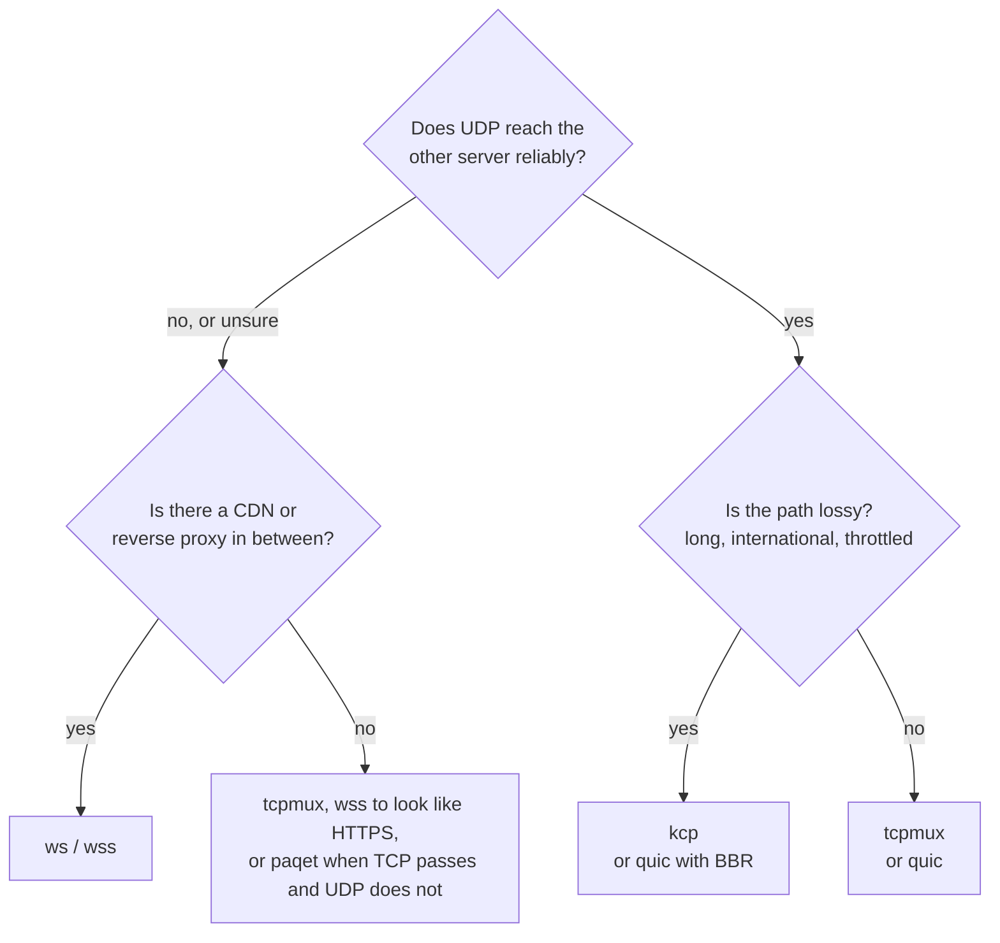

# ترنسپورت‌ها

[English](../transports.md) · **فارسی**

ترنسپورت راهی است که تانل بین دو سرور از آن می‌گذرد. فقط یک خط است، `tunnel.transport`، و باید روی هر دو سمت یکی باشد.



| ترنسپورت | روی شبکه چه می‌رود | کی انتخابش کنید |
|---|---|---|
| `tcp` | برای هر اتصال کاربر یک اتصال TCP | تنظیم‌های ساده، بیشترین سرعت روی یک اتصال |
| `tcpmux` | چند اتصال TCP بلندمدت که همهٔ اتصال‌های کاربرها را می‌برند | اتصال‌های کاربرِ زیاد؛ اتصال کمتر بین دو سرور |
| `ws` | WebSocket روی TCP (HTTP) | پشت CDN یا reverse proxy که با سرور اصلی با HTTP حرف می‌زند |
| `wss` | WebSocket روی TLS (HTTPS) | پشت CDN، یا وقتی می‌خواهید ترافیک شبیه یک سایت HTTPS باشد |
| `ws` / `wss` با `mode = "httpupgrade"` | همان upgrade در HTTP، بعد بایت‌های خام (بدون فریم وب‌سوکت) | مثل `ws` / `wss`، با پردازش و سربار کمتر |
| `wss` با `mode = "tls"` | TLS و تانل درونش، بدون HTTP | سبک‌ترین راه برای شبیه یک سرور HTTPS بودن؛ نه از پشت CDN |
| `quic` | QUIC روی UDP: streamها و datagramها، با TLS 1.3 | جریان‌های UDP بدون head-of-line blocking؛ مسیرهایی که UDP در آن‌ها خوب کار می‌کند |
| `kcp` | KCP روی UDP، هر بسته رمزشده، با FEC اختیاری | مسیرهای پراتلاف که TCP در آن‌ها از پا می‌افتد؛ بازی |
| [`paqet`](paqet.md) | همان KCP رمزشده، داخل بسته‌های خام TCP بدون دست‌دهی (IPv4، لینوکس) | UDP بسته یا کند است ولی TCP رد می‌شود |
| `icmp` | همان KCP رمزشده، داخل payload بسته‌های ICMP echo (پینگ) (IPv4، لینوکس، root) | UDP و TCP بسته‌اند ولی پینگ رد می‌شود |
| `dns` | همان KCP رمزشده، پیچیده در پیام‌های پرس‌وجو/پاسخ DNS روی UDP 53 | فقط DNS رد می‌شود؛ پیوند مستقیم سرور-به-سرور |
| `grpc` | تونل به‌شکل یک فراخوان gRPC دوطرفه روی HTTP/2 (در این فاز h2c متن‌ساده) | پشت CDN یا پروکسی‌ای که gRPC می‌فهمد |

همهٔ ترنسپورت‌ها جز `quic` لایه‌های یکسانی را روی خود اجرا می‌کنند: handshake (احراز هویت دوطرفه با توکن، و X25519 برای forward secrecy)، رکوردهای AEAD و mux.

## `tcp` و `tcpmux`

`tcp` برای هر اتصال کاربر یک اتصال تانل باز می‌کند. در حالت reverse، خروجی به تعداد `pool` اتصال آماده نگه می‌دارد تا کاربر تازه برای handshake منتظر نماند؛ در حالت direct، اولین بایت‌های کاربر همراه handshake می‌روند.

`tcpmux` همان `tcp` است، با mux: چند اتصال بلندمدت که هر کدام streamهای زیادی را حمل می‌کنند و هر stream کنترل جریان خودش را دارد. باز کردن یک stream هیچ رفت‌وبرگشتی لازم ندارد. روی لینوکس کرم‌چاله روی این اتصال‌ها `TCP_NOTSENT_LOWAT` را تنظیم می‌کند تا هسته صفی از داده نگه ندارد که بسته‌های UDP و streamهای تازه پشتش معطل بمانند.

روی مسیر تمیز، هر دو سریع‌ترین انتخاب‌اند. روی مسیر پراتلاف، کنترل ازدحام TCP با هر اتلاف سرعتش را نصف می‌کند: با ۱٪ اتلاف روی مسیری با ۶۰ میلی‌ثانیه تأخیر، حدود ۲ مگابیت بر ثانیه.

## `ws` و `wss`

یک WebSocket که شبیه مرورگر رفتار می‌کند، روی HTTP ساده (`ws`) یا TLS (`wss`). از CDN و reverse proxy رد می‌شوند ([راهنما](CDN.md)).

- **Early data** (`ws.early_data = true` روی سمت وصل‌شونده) پیام اول تانل را داخل درخواست upgrade می‌گذارد و یک رفت‌وبرگشت در مسیر CDN صرفه‌جویی می‌کند.
- **هر چیزی که upgrade معتبر نباشد** روی مسیر تنظیم‌شده صفحهٔ `404` یک nginx معمولی را می‌گیرد.
- **گواهی `wss`:** یا یک گواهی واقعی (Let's Encrypt) که با عوض شدن فایل‌ها دوباره بارگذاری می‌شود، یا یک گواهی خودامضا که سمت وصل‌شونده با `tls.pin_sha256` آن را pin می‌کند (`wormhole pin cert.pem`).
- پشت CDN، فاصلهٔ ping را ۹۰ ثانیه یا کمتر نگه دارید؛ CDN وب‌سوکت‌های بی‌کار را حدود ۱۰۰ ثانیه بعد می‌بندد. `wormhole check` در غیر این صورت هشدار می‌دهد.

## HTTPUpgrade و TLS خالص

`[tunnel.ws] mode` تعیین می‌کند داخل یک اتصال `ws` یا `wss` چه چیزی جریان دارد. باید روی هر دو سمت یکی
باشد و هر دو سرور به نسخهٔ ۱٫۱٫۰ یا جدیدتر نیاز دارند. در ویزارد تانل پنل، زیر ترنسپورت و برای `ws` و
`wss`، با نام «شکل انتقال» آمده است.

```toml
[tunnel]
transport = "wss"

[tunnel.ws]
mode = "httpupgrade"   # یا "websocket" (پیش‌فرض)، یا "tls" (فقط wss)
path = "/api/v1/upload"
```

- **`websocket`** (پیش‌فرض): فریم‌های دودویی RFC 6455. سمت وصل‌شونده هر بایتی را که می‌فرستد ماسک
  می‌کند (استاندارد از کلاینت می‌خواهد) و هر دو سمت به هر نوشتن یک سرآیند فریم اضافه می‌کنند.
- **`httpupgrade`**: سمت وصل‌شونده دقیقاً همان درخواست upgrade را می‌فرستد (CDN یا reverse proxy یک
  وب‌سوکت می‌بیند و همان‌طور با آن رفتار می‌کند) و شنونده مثل قبل `101` جواب می‌دهد؛ از آن به بعد بایت‌های
  خود تانل بدون قاب‌بندی و بدون ماسک می‌روند. XOR روی تک‌تک بایت‌ها در سمت وصل‌شونده و ۲ تا ۱۴ بایت در هر
  نوشتن صرفه‌جویی می‌شود، که در سرعت‌های بالا و روی CPUهای ضعیف پیداست. early data، مسیر، `host`، صفحهٔ
  `404` برای هر چیز دیگر، و گواهی واقعی یا پین‌شده مثل `websocket` کار می‌کنند. Cloudflare و nginx آن را
  رد می‌کنند، همان‌طور که `httpupgrade` در Xray را؛ پروکسی‌ای که فریم‌های وب‌سوکت را بازرسی کند نه (آنجا
  `websocket` را بگذارید).
- **`tls`** (فقط `wss`؛ با نام `raw` هم پذیرفته می‌شود): TLS، و بایت‌های تانل درست بعد از دست‌دادن TLS،
  بدون هیچ HTTP. روی سیم یک اتصال HTTPS معمولی به نامِ `tls.sni` است، با کمترین سربار میان ترنسپورت‌های
  TLS. هیچ CDNی نمی‌تواند حملش کند (CDN به HTTP نیاز دارد)، پس برای مسیرهای مستقیم است. هر چیزی که بدون
  توکن وصل شود یک دست‌دادن TLS و بعد سکوت می‌گیرد، مثل یک سرور واقعی. `path` و `host` و `early_data`
  استفاده نمی‌شوند.

هر سه همان دست‌دادن، رکوردها و mux را رویشان اجرا می‌کنند؛ پس رمزنگاری، پروفایل‌ها، UDP و نمودارهای پنل
یکسان‌اند.

## `quic`

QUIC (با quinn) روی UDP:

- هر اتصال کاربر stream خودش را در QUIC دارد: بستهٔ گم‌شده فقط stream خودش را عقب می‌اندازد.
- جریان‌های UDP به‌شکل datagramهای QUIC می‌روند. بسته‌هایی که برای یک datagram بزرگ‌اند (بالای حدود ۱٬۲۰۰ بایت) روی stream همان جریان می‌روند و باز هم می‌رسند.
- دو سمت توکن را با TLS 1.3 دوطرفه و با کلیدهایی که از آن ساخته می‌شود اثبات می‌کنند؛ فایل گواهی لازم نیست.
- کنترل ازدحام: `cubic` (پیش‌فرض)، `bbr` (زیر اتلاف تصادفی سرعتش را نگه می‌دارد، ولی صف‌ها را پر می‌کند و در quinn آزمایشی است) یا `newreno`.
- handshake شبیه HTTP/3 دیده می‌شود (ALPN برابر `h3` و SNI نام میزبان مقابل)، مگر این‌که `obfs` روشن باشد.

بعضی شبکه‌ها UDP را کند یا مسدود می‌کنند، به‌ویژه UDP روی پورت ۴۴۳. `quic` را گزینه‌ای برای مسیرهایی بدانید که UDP در آن‌ها کار می‌کند، و `tcpmux` یا `wss` را جایگزینش نگه دارید.

### `obfs`

بسته‌های اول QUIC را هر کسی می‌تواند بخواند. پس شبکه‌ای که دنبال QUIC می‌گردد (و روی SNI آن فیلتر می‌کند) می‌تواند آن را تشخیص بدهد و بیندازد، حتی جایی که UDP‌های دیگر رد می‌شوند. اگر در `[tunnel.quic]` روی **هر دو سمت** `obfs = true` بگذارید، هر بستهٔ UDP با کلیدی که از توکن می‌آید مهر و موم می‌شود (ChaCha20-Poly1305، مثل `kcp`). آن‌وقت روی سیم هدر QUIC و شمارهٔ نسخه‌ای برای تطبیق دادن نیست و پورت به چیزی که با توکن مهر نشده باشد جواب نمی‌دهد. درون تانل چیزی عوض نمی‌شود: handshake در TLS 1.3 و streamها مثل قبل کار می‌کنند.

- برای هر بسته ۲۸ بایت خرج دارد (اندازهٔ بستهٔ QUIC همان‌قدر کم می‌شود، پس بسته‌های روی سیم هم‌اندازه می‌مانند) و کمی CPU.
- هر دو سمت باید یک جور تنظیم شده باشند. سمتی که آن را نمی‌فهمد فقط نویز می‌بیند و سمت دیگر هنگام اتصال timeout می‌خورد. در ویزارد تانل پنل، این یک کلید زیر ترنسپورت است که برای `quic` پیش‌فرض روشن است.
- این گزینه پروتکل را پنهان می‌کند، نه این‌که UDP به این آدرس می‌رود. جایی که کل UDP بسته است کمکی نمی‌کند (از `tcpmux` یا `wss` استفاده کنید).

لینک پنل با سرورها هم می‌تواند `quic` باشد و آن همیشه مهر و موم‌شده است، بی‌هیچ تنظیمی: [پنل وب](panel.md#وصل-کردن-سرور-دیگر).

## `kcp`

KCP یک پروتکل ARQ روی UDP است که با شدت دوباره می‌فرستد و زیر اتلاف سرعتش را نگه می‌دارد، یعنی همان‌جا که TCP از پا می‌افتد.

- **هر بستهٔ UDP مهر و موم می‌شود** با کلیدی از توکن، پس پورت به هیچ چیز دیگری جواب نمی‌دهد و هدرهای KCP پنهان می‌مانند. handshake، رکوردها و mux مثل TCP داخل آن اجرا می‌شوند.
- **پیش‌تنظیم‌ها** از ملایم تا تند (`normal`، `fast`، `fast2`، `fast3`) یا `manual`.
- **FEC** (`fec_data` / `fec_parity`): بسته‌های parity از نوع Reed-Solomon بسته‌های گم‌شده را بدون ارسال دوباره بازسازی می‌کنند. پروفایل gaming آن را روی ۱۰ / ۳ می‌گذارد.
- **جریان‌های UDP کنار stream در KCP می‌روند** و هیچ‌وقت منتظر segment گم‌شده نمی‌مانند. با FEC روشن بیشتر بسته‌های گم‌شده بازسازی می‌شوند. با `datagrams = false` آن‌ها هم داخل stream می‌مانند.
- **پنجرهٔ آن می‌تواند مسیر کوچک را پر کند.** پیش‌فرض (۱۰۲۴ بسته) برای لینک‌های سریع اندازه شده؛ مقدار پهنای‌باند × RTT / 1300 بسته صف کمتری می‌سازد.

KCP در فضای کاربر و بسته‌به‌بسته اجرا می‌شود، پس روی localhost فقط به کسری از سرعت TCP می‌رسد (صدها مگابیت بر ثانیه). بین دو سرور معمولاً اهمیتی ندارد.

## `paqet`

Paqet بسته‌های `kcp` را (مهرشده با توکن، با همان حالت‌ها، FEC و پنجره‌ها) به‌جای
دیتاگرام UDP داخل بسته‌های خام TCP می‌برد. هر بسته شبیه دادهٔ یک اتصال TCP برقرار است و
هیچ دست‌دهی‌ای در کار نیست. برای مسیرهایی است که UDP را می‌بندند یا کند می‌کنند ولی TCP
را رد می‌کنند.

- **هیچ کار دستی‌ای لازم نیست.** سرویس تونل سوکت خام را باز می‌کند، قواعد فایروالی را که
  Paqet لازم دارد می‌گذارد و با توقف تونل برمی‌دارد.
- **فقط IPv4، و نه روی GRE یا VXLAN**: داخل شبکهٔ خصوصی فیلتر فقط بسته‌های بیرونی را
  می‌بیند و Paqet آنجا فایده‌ای ندارد. پنل هیچ‌کدام را برای Paqet پیشنهاد نمی‌دهد.
- **همان تنظیم‌های `kcp`:** پروفایل، `[tunnel.mux]`، `[tunnel.kcp]` و `[tuning]`.
- **مسیری می‌خواهد که TCP بدون دست‌دهی را رد کند.** فایروال حالت‌داری جلوی سرور که چنین
  بسته‌هایی را دور می‌ریزد جلویش را می‌گیرد (`handshake timed out`).

راهنمای کامل، با نمونه و عیب‌یابی: [ترنسپورت Paqet روی TCP خام](paqet.md).

## `icmp`

`transport = "icmp"` بسته‌های `kcp` را (مهرشده با توکن، با همان حالت‌ها، FEC و پنجره‌ها)
داخل payload بسته‌های **ICMP echo request** — یعنی بسته‌های معمولی `ping` — روی سوکت خام
می‌برد. برای سخت‌ترین مسیرهاست: جایی که هم UDP و هم TCP بسته یا کند است ولی ICMP (پینگ)
همچنان رد می‌شود.

```toml
[tunnel]
transport = "icmp"
listen = "0.0.0.0:4000"       # سمت شنونده: این پورت شناسهٔ ICMP echo است، نه پورت TCP/UDP
# remote = "203.0.113.9:4000" # سمت تماس‌گیرنده: آدرس واقعی و شناسهٔ طرف مقابل
```

- **هیچ کار دستی‌ای لازم نیست.** سرویس تونل سوکت خام را باز می‌کند و قواعد فایروالِ
  اسکوپ‌شدهٔ خودش را می‌گذارد و با توقف برمی‌دارد. هر دو طرف echo *request* می‌فرستند، پس
  تنها echo *reply*های روی سیم، پاسخ‌های خودکار کرنل‌اند؛ یک قاعده همان‌ها را برای طرف مقابل
  حذف می‌کند تا ترافیک دوبرابر نشود، بی‌آنکه به تونل دست بزند.
- **پورت یک شناسهٔ ICMP است، نه پورت واقعی.** ICMP پورت ندارد، پس کرم‌چاله از شناسهٔ echo
  (از `listen` / `remote`) استفاده می‌کند تا چند تونل — و `ping` خود میزبان — را از هم جدا
  کند. هیچ پورت TCP یا UDP را رزرو نمی‌کند.
- **فقط IPv4، نیازمند root** (یا `CAP_NET_RAW`)، **و نه روی GRE یا VXLAN**: داخل شبکهٔ
  خصوصی فیلتر فقط بسته‌های بیرونی را می‌بیند و پوشش فایده‌ای ندارد. پنل هیچ‌کدام را برای
  `icmp` پیشنهاد نمی‌دهد.
- **همان تنظیم‌های `kcp`:** پروفایل، `[tunnel.mux]` و `[tuning]`. (تنظیم سفارشی
  `[tunnel.kcp]` در پنل فقط برای Paqet است؛ `icmp` از پیش‌فرض‌های KCP پروفایل استفاده می‌کند.)
- **مسیری می‌خواهد که ICMP echo را رد کند.** جایی که پینگ دور ریخته یا محدود می‌شود، از
  `paqet` یا `wss` استفاده کنید.

هر دو طرف echo request می‌فرستند (هرگز reply)، پس جفت‌شدن ping/pong در کار نیست؛ فیلدهای
identifier و sequence بستهٔ echo، شناسهٔ دو طرف را حمل می‌کنند تا پاسخ‌ها راهشان را پیدا کنند
و دو طرف حتی روی loopback هم از هم متمایز بمانند. روی هر دو سرور به 1.2.0 نیاز دارد.

## `dns`

`transport = "dns"` بسته‌های `kcp` را (مهرشده با توکن) پیچیده در **پیام‌های پرس‌وجو/پاسخ DNS**
روی UDP می‌برد. سمت تماس‌گیرنده پرس‌وجو می‌فرستد و سمت شنونده پاسخ، پس فیلتری که فقط DNS روی
UDP 53 را رد می‌کند تونل را عبور می‌دهد.

```toml
[tunnel]
transport = "dns"
listen = "0.0.0.0:53"         # سمت شنونده: UDP 53، جایی که فیلتر DNS انتظار ترافیک دارد (نیازمند root)
# remote = "203.0.113.9:53"   # سمت تماس‌گیرنده: آدرس و پورت DNS طرف مقابل
```

- **تونل مستقیم سرور-به-سرور است، نه از راه resolver.** چون دو سرور مستقیم با هم حرف می‌زنند،
  بستهٔ مهرشده کامل در RDATA یک رکورد می‌رود، نه این‌که در نام پرس‌وجو فشرده شود (که resolver
  واقعی محدودش می‌کند). روی مسیر شبیه DNS است؛ اما از عبور از یک سرور DNS واقعی جان سالم به در
  نمی‌برد.
- **پورت ۵۳ به root نیاز دارد** (یا `CAP_NET_BIND_SERVICE`) در سمت شنونده، برای گرفتن پورت
  ممتاز. سمت تماس‌گیرنده به چیز خاصی نیاز ندارد.
- **روی IPv4 و IPv6 کار می‌کند**، و اگر خواستید روی شبکهٔ خصوصی هم (برخلاف ترنسپورت‌های خام).
- **MTU کوچک.** هر بسته در یک پیام DNS که داخل یک بافر رایج EDNS0 می‌ماند پیچیده می‌شود، پس MTU
  مربوط به KCP محدود است (حدود ۱۱۳۶ بایت)؛ گذردهی از بقیهٔ ترنسپورت‌ها کمتر است. DNS یک حامل
  آخرین‌چاره است.
- **همان تنظیم‌های `kcp`:** پروفایل، `[tunnel.mux]` و `[tuning]`.

در پنل: در ویزارد و ویرایش تانل، *DNS* را به‌عنوان ترنسپورت انتخاب کنید. روی هر دو سرور به
1.2.0 نیاز دارد.

## `grpc`

`transport = "grpc"` تونل را به‌شکل یک **فراخوان gRPC دوطرفه روی HTTP/2** می‌برد. سمت
تماس‌گیرنده یک `POST` به مسیری شبیه gRPC با `content-type: application/grpc` باز می‌کند، سمت
شنونده `200` پاسخ می‌دهد، و بایت‌های تونل داخل پیام‌های طول‌دارِ gRPC جابه‌جا می‌شوند. برای عبور
از CDN یا reverse proxy‌ای است که gRPC/HTTP-2 می‌فهمد.

```toml
[tunnel]
transport = "grpc"
listen = "0.0.0.0:2096"       # سمت شنونده: پورت HTTP/2 که CDN/پروکسی gRPC را به آن می‌فرستد
# remote = "203.0.113.9:2096" # سمت تماس‌گیرنده: نقطهٔ پایانی gRPC طرف مقابل
```

- **در این فاز HTTP/2 متن‌ساده (h2c).** برای استفاده از CDN، آن را **پشت CDN یا پروکسی‌ای که
  TLS را خاتمه می‌دهد** بگذارید و gRPC را به این پورت بفرستد — همان‌طور که gRPC معمولاً پشت
  Cloudflare یا nginx یا Caddy اجرا می‌شود. (TLS بومی با ALPN `h2` که به فرانت نیاز نداشته باشد،
  کار بعدی است.)
- **یک ترنسپورت جریانی** مثل `tcp` و `ws`: دست‌دهی، رمزنگاری و `[tunnel.mux]` روی آن اجرا
  می‌شوند. HTTP/2 با کرِیت `h2` فراهم می‌شود، پشت ویژگی کارگو `grpc` (به‌صورت پیش‌فرض روشن).
- **بدون نیاز به root، روی IPv4 یا IPv6.**

در پنل: *gRPC* را به‌عنوان ترنسپورت انتخاب کنید. روی هر دو سرور به 1.2.0 نیاز دارد.

## `wss` با گواهی واقعی

گوش‌دهندهٔ `wss` به‌طور پیش‌فرض یک گواهی خودامضا می‌دهد که سمت وصل‌شونده pin می‌کند. در پنل می‌توانید به‌جای آن *Let's Encrypt* را انتخاب کنید، یک دامنه (یا آدرس IPv4 عمومی) بدهید که به سرور گوش‌دهنده اشاره می‌کند و دکمه را بزنید. سرور `wormhole-manager tunnel-cert` را اجرا می‌کند؛ آن هرچه پورت ۸۰ را گرفته چند ثانیه متوقف می‌کند، گواهی را می‌گیرد و تایمر تمدید را راه می‌اندازد. بعد تانل فایل‌های زیر `/etc/letsencrypt/live/` را نام می‌برد (`tunnel.tls.cert` و `key`)، هنگام تمدید دوباره می‌خواندشان، و سمت وصل‌شونده گواهی را با ریشه‌های وب می‌سنجد (بدون pin).

**گواهی خودتان** هم همین‌طور کار می‌کند: *گواهی خودتان* را انتخاب کنید و مسیر فایل زنجیرهٔ کامل و کلید خصوصی آن روی سرور گوش‌دهنده (PEM، بدون رمز عبور؛ مسیر کامل که به `.pem`، `.crt`، `.cer` یا `.key` ختم شود) و دامنه (یا آدرس IPv4) گواهی را بدهید. پیش از تغییر تانل، سرور می‌سنجد که فایل‌ها آنجا باشند و کلید مال همین گواهی باشد. باید گواهی‌ای باشد که مرورگرها به آن اعتماد دارند (از acme.sh، سرویس‌دهنده یا یک CA)، چون سمت وصل‌شونده آن را با ریشه‌های وب می‌سنجد. کرم‌چاله آن را تمدید نمی‌کند، ولی وقتی خودتان تمدیدش کنید تانل فایل‌های تازه را خودش می‌خواند. سرور گوش‌دهنده باید ۱٫۰٫۰ یا جدیدتر باشد.

سمت وصل‌شونده گواهی را با **نامی که برایش صادر شده** می‌سنجد: پنل همین را `tls.sni` آن می‌گذارد، پس فرقی نمی‌کند به کدام آدرس وصل شود (آدرس خصوصی GRE، یا آدرس دیگری از همان سرور) یا چه *Host*ی در WebSocket بفرستد. گواهی‌ای که با نام دیگری سنجیده شود رد می‌شود و سمت گوش‌دهنده `received fatal alert: BadCertificate` می‌نویسد؛ در کانفیگی که دستی نوشته‌اید، `tls.sni` را دامنه یا آدرس گواهی بگذارید.

## `auto`

`transport = "auto"` برای شبکه‌هایی است که نمی‌دانید از کدام راه رد می‌شوند، یا راهی که کار می‌کرد از کار افتاده. سمتی که گوش می‌دهد همهٔ این‌ها را هم‌زمان باز می‌کند:

| ترنسپورت | پورت |
|---|---|
| `tcpmux` | TCP، پورت خود تانل |
| `kcp` | UDP، همان شمارهٔ پورت |
| `ws` | TCP، پورت بعدی (مسیر وب‌سوکت از توکن ساخته می‌شود) |

سمت وصل‌شونده با همان راهی شروع می‌کند که آخرین بار کار کرد. اگر وصل شدن چهار ثانیه گیر کند یا شکست بخورد، سراغ بعدی می‌رود و همین‌طور دور می‌زند، و آن را که رد شد به یاد می‌سپارد. این حالت همیشه mux دارد و هر ۲ ثانیه ping می‌زند (`tunnel.mux.ping_interval_secs` آن را عوض می‌کند)؛ پس لینکی که ساکت شود حدود ۴ ثانیه بعد رها می‌شود و با هر ترنسپورتی که رد شود دوباره ساخته می‌شود. هر سه پورت باید سمت گوش‌دهنده باز باشند. اگر پورت UDP یا `ws` گرفته شده باشد، آن ترنسپورت کنار گذاشته می‌شود (و در لاگ می‌آید)، ولی `tcpmux` باید بتواند bind شود. `[tunnel.kcp]` برای بخش KCP آن اعمال می‌شود؛ `[tunnel.ws]` و `[tunnel.tls]` به کار نمی‌روند.

### همهٔ ترنسپورت‌ها هم‌زمان (`spread`)

```toml
[tunnel]
transport = "auto"

[tunnel.mux]
spread = true
```

با `spread` سمت وصل‌شونده یک ترنسپورت انتخاب نمی‌کند: هم‌زمان روی `tcpmux` و `kcp` و `ws` session نگه می‌دارد (`mux.connections` بین این سه پخش می‌شود، دست‌کم یکی برای هرکدام)، و هر اتصال کاربر یا جریان UDP تازه به sessionی می‌رود که کمترین انتظار را دارد: تعداد جریان‌هایش، وزن‌داده‌شده با زمان رفت‌وبرگشتش. مسیر سریع‌تر سهم بیشتری می‌برد، و مسیری که پاسخ pingهایش برنگردد همان لحظه کنار گذاشته می‌شود، پیش از آنکه timeout شود. وقتی شبکه یکی از این سه را ببندد، sessionهایش بسته می‌شوند و بقیه ادامه می‌دهند: کسی منتظر وصل‌شدن دوباره نمی‌ماند. تا وقتی هر سه بالا هستند وضعیت `kcp+tcpmux+ws` نشان می‌دهد.

واحد پخش، اتصال یا جریان است نه بسته: یک دانلود تکی همچنان از یک مسیر می‌رود، و کاربرهای زیاد با هم از همهٔ مسیرها استفاده می‌کنند. فقط سمت وصل‌شونده تغییر می‌کند، ولی پنل این تنظیم را برای هر دو سمت می‌نویسد، پس هر دو سرور باید ۲٫۹٫۰ داشته باشند.

## `spoof`

`transport = "spoof"` همان `paqet` است (KCP داخل TCP مصنوعی IPv4 روی سوکت خام) با یک تفاوت: **آدرس مبدأ IP جعل می‌شود**. برای فایروال لیست‌سفید لایهٔ ۳ است که فقط ترافیکی را رد می‌کند که ادعا کند از یک آدرس لیست‌سفید می‌آید.

```toml
[tunnel]
transport = "spoof"
listen = "0.0.0.0:8090"       # پذیرنده: پورت واقعی که گوش می‌دهد
# remote = "203.0.113.5:8090" # وصل‌شونده: آدرس واقعی طرف مقابل

[tunnel.spoof]
spoof_ip      = "5.6.7.8"      # مبدأ جعلی این طرف (یا spoof_ips = [...] چرخشی)
peer_ip       = "203.0.113.9"  # آدرس واقعی طرف مقابل (روی سمت گوش‌دهنده لازم)
# peer_spoof_ip = "9.10.11.12"  # فیلتر دریافت اختیاری (مبدأیی که طرف مقابل جعل می‌کند)
# port        = 443             # پورت مبدأ TCP جعلی اختیاری (پیش‌فرض: پورت واقعی)
```

هر طرف بسته‌ها را با مبدأ جعلی به آدرس **واقعی** طرف دیگر می‌فرستد و پاسخ با مبدأ جعلی طرف دیگر برمی‌گردد. هر بسته همچنان با توکن رمزنگاری و احراز می‌شود، پس بستهٔ جعلی از هر کس دیگری دور انداخته می‌شود؛ فیلتر `peer_spoof_ip` فقط بهینه‌سازی است.

سه چیز لازم دارد که بیشتر سرورها ندارند، پس اول تست کنید: شبکه‌ای که جعل مبدأ خروجی را اجازه دهد (بیشتر providerها با BCP38/uRPF بلاکش می‌کنند)، لینوکس با root یا CAP_NET_RAW، و IPv4. سمتی که گوش می‌دهد باید آدرس واقعی طرف مقابل (`peer_ip`) را بداند، چون بستهٔ جعلی مبدأ را پنهان می‌کند. `spoof` همیشه mux دارد و همهٔ تنظیمات `[tunnel.kcp]` را برای wire خود به کار می‌برد. روی هر دو سرور به ۱٫۰٫۰ نیاز دارد. جعل مبدأ خلاف قوانین بیشتر providerهاست.

## حالت‌ها و ترنسپورت‌ها

هر ترنسپورتی در هر دو حالت کار می‌کند. سمتی که گوش می‌دهد باید پورتش در دسترس باشد: TCP برای `tcp`، `tcpmux`، `ws`، `wss`، `paqet` و `grpc`، UDP برای `quic`، `kcp` و `dns`، و ICMP echo برای `icmp` (بدون هیچ پورتی). برای `paqet` و `icmp` کرم‌چاله فایروال خود میزبان را باز می‌کند؛ فایروالی که جلوی سرور است باید همچنان پورت TCP (یا ICMP) را رد کند.
