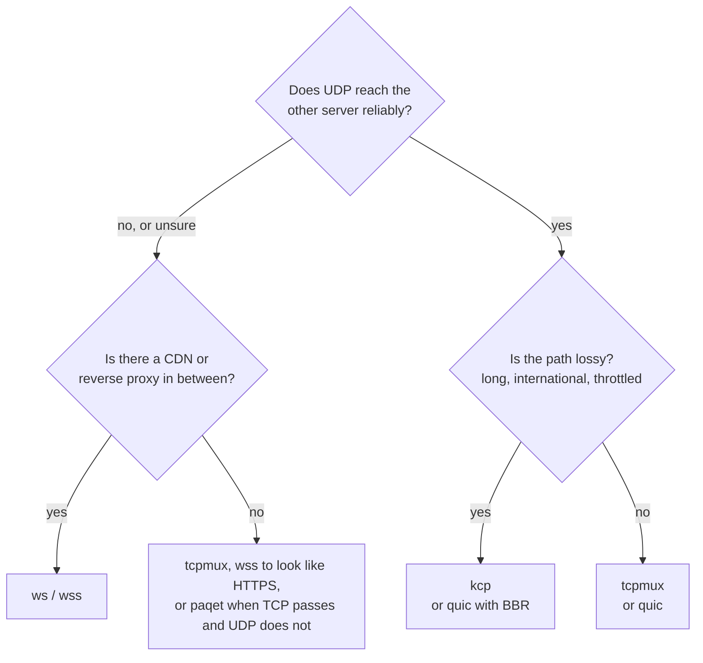

# Transports

The transport is how the tunnel travels between the two servers. It is one line,
`tunnel.transport`, and must be the same on both sides.



| Transport | What goes over the network | Use it when |
|---|---|---|
| `tcp` | one TCP connection per user connection | simple setups, the most speed on one connection |
| `tcpmux` | a few long-lived TCP connections carrying all user connections | many user connections; fewer connections between the servers |
| `ws` | WebSocket over TCP (HTTP) | behind a CDN or reverse proxy that talks HTTP to the origin |
| `wss` | WebSocket over TLS (HTTPS) | behind a CDN, or on its own to look like an HTTPS site |
| `ws` / `wss` + `mode = "httpupgrade"` | the same HTTP upgrade, then bare bytes (no WebSocket frames) | as `ws` / `wss`, with less CPU and overhead |
| `wss` + `mode = "tls"` | TLS and the tunnel inside, no HTTP | to look like an HTTPS server, the lightest way; not through a CDN |
| `quic` | QUIC over UDP: streams and datagrams, TLS 1.3 | UDP flows without head-of-line blocking; paths where UDP works well |
| `kcp` | KCP over UDP, every packet encrypted, optional FEC | lossy links where TCP collapses; games |
| [`paqet`](paqet.md) | the same encrypted KCP, in raw TCP segments with no handshake (IPv4, Linux) | UDP is blocked or throttled but TCP gets through |
| `icmp` | the same encrypted KCP, in the payload of ICMP echo (ping) packets (IPv4, Linux, root) | UDP and TCP are blocked but ping still gets through |
| `dns` | the same encrypted KCP, wrapped in DNS query/response messages over UDP 53 | only DNS passes; a direct server-to-server link |

Everything except `quic` runs the same layers on top: the handshake (mutual
authentication with the token, X25519 for forward secrecy), AEAD records, and mux.

## `tcp` and `tcpmux`

`tcp` opens one tunnel connection per user connection. In reverse mode the exit keeps
`pool` connections ready so a new user does not wait for the handshake; in direct mode
the user's first bytes ride along with the handshake.

`tcpmux` is `tcp` with mux: a few long-lived connections, each carrying many streams
with their own flow control. Opening a stream costs no round trip. On Linux, Wormhole sets
`TCP_NOTSENT_LOWAT` on these connections so the kernel does not hold a backlog that
UDP packets and new streams would wait behind.

Both are the fastest choice on a clean path. On a lossy one, TCP's congestion control
halves its rate on every loss: at 1 % loss on a 60 ms path, about 2 Mbit/s.

## `ws` and `wss`

A WebSocket that looks like a browser's, over plain HTTP (`ws`) or TLS (`wss`). They
work through CDNs and reverse proxies ([guide](CDN.md)).

- **Early data** (`ws.early_data = true` on the dialer) puts the tunnel hello inside
  the upgrade request, saving a round trip through the CDN.
- **Anything that is not a valid upgrade** on the configured path gets the `404` page of
  a stock nginx.
- **`wss` certificates:** a real one (Let's Encrypt), reloaded when the files change, or
  a self-signed one pinned on the dialer with `tls.pin_sha256` (`wormhole pin cert.pem`).
- Keep pings at 90 s or less behind a CDN, which closes idle WebSockets after about
  100 s. `wormhole check` warns otherwise.

## HTTPUpgrade and plain TLS

`[tunnel.ws] mode` changes what runs inside a `ws` or `wss` connection. It must be the same on
both sides, and both servers need 1.1.0 or newer. In the panel's tunnel wizard it is *Carried
as*, under the transport, for `ws` and `wss`.

```toml
[tunnel]
transport = "wss"

[tunnel.ws]
mode = "httpupgrade"   # or "websocket" (the default), or "tls" (wss only)
path = "/api/v1/upload"
```

- **`websocket`** (default): RFC 6455 binary frames. The dialing side masks every byte it sends
  (the standard requires it of a client) and both sides add a frame header to every write.
- **`httpupgrade`**: the dialing side sends exactly the same upgrade request (a CDN or reverse
  proxy sees a WebSocket and treats it as one) and the listening side answers `101` as before;
  after that the tunnel's own bytes go as they are, with no framing and no masking. It saves the
  XOR of every byte on the dialing side and 2 to 14 bytes per write, which shows at high speeds
  and on small CPUs. Early data, the path, `host`, the `404` page for anything else, and real or
  pinned certificates work as with `websocket`. Cloudflare and nginx pass it, as they do Xray's
  `httpupgrade`; a proxy that inspects WebSocket frames does not (use `websocket` there).
- **`tls`** (`wss` only; also accepted as `raw`): TLS, and the tunnel's bytes right after the
  TLS handshake, with no HTTP at all. On the wire it is an ordinary HTTPS connection to the
  name in `tls.sni`, with the least overhead of the TLS transports. No CDN can carry it (a CDN
  needs HTTP), so it is for direct routes. Anything that connects without the token gets a
  TLS handshake and then silence, as a server would. `path`, `host` and `early_data` are not
  used.

All three run the same handshake, records and mux on top, so encryption, profiles, UDP and
the panel's charts are the same.

## `quic`

QUIC (quinn), over UDP:

- Each user connection is its own QUIC stream: a lost packet delays only its own
  stream.
- UDP flows travel as QUIC datagrams. Packets too large for a datagram (above about
  1,200 bytes) go on the flow's stream instead, so they still arrive.
- Both sides prove the token with mutual TLS 1.3 using keys derived from it: no
  certificate files.
- Congestion control: `cubic` (default), `bbr` (keeps its speed under random loss, but
  fills queues; experimental in quinn) or `newreno`.
- The handshake reads as HTTP/3 (ALPN `h3`, SNI of the remote host), unless `obfs` is on.

Some networks throttle or block UDP, and UDP on port 443 in particular. Treat `quic` as
an option for paths where UDP works, with `tcpmux` or `wss` as the fallback.

### `obfs`

QUIC's first packets can be read by anyone, so a network that looks for QUIC (and filters
by the SNI in it) can spot and drop it even where other UDP passes. `obfs = true` in
`[tunnel.quic]`, on both sides, seals every UDP packet with a key derived from the token
(ChaCha20-Poly1305, as `kcp` does): on the wire there is no QUIC header or version to
match, and the port answers nothing that was not sealed with the token. It changes nothing
inside: the TLS 1.3 handshake and the streams run as before.

- It costs 28 bytes a packet (QUIC's packet size is lowered by as much, so the packets on
  the wire stay the same size) and some CPU.
- Both sides must agree. A side that does not speak it sees noise, and the other side
  times out connecting. In the panel's tunnel wizard it is a switch under the transport,
  on by default for `quic`.
- It hides the protocol, not the fact that UDP flows to this address; where all UDP is
  blocked it does not help (use `tcpmux` or `wss`).

The link between the panel and a server can be `quic` too, and that one is always sealed, with no
setting: [The web panel](panel.md#connect-another-server).

## `kcp`

KCP is an ARQ protocol over UDP that resends aggressively and keeps its rate under
loss, where TCP collapses.

- **Every UDP packet is sealed** with a key from the token, so the port answers nothing
  else and KCP's headers are hidden. The handshake, records and mux run inside it as
  over TCP.
- **Presets** from gentle to aggressive (`normal`, `fast`, `fast2`, `fast3`) or
  `manual`.
- **FEC** (`fec_data` / `fec_parity`): Reed-Solomon parity rebuilds lost packets without
  a resend. The gaming profile turns on 10 / 3.
- **UDP flows travel beside KCP's stream**, never waiting for a lost segment. With FEC
  on, lost ones are mostly rebuilt. `datagrams = false` keeps them in the stream
  instead.
- **Its window can overfill a small path.** The default (1024 packets) is sized for
  fast links; about bandwidth x RTT / 1300 packets queues less.

KCP runs in user space, a packet at a time, so on localhost it reaches a fraction of
TCP's speed (hundreds of Mbit/s). Between two servers this rarely matters.

## `paqet`

Paqet carries the packets of `kcp` (sealed with the token, with the same presets, FEC and
windows) inside raw TCP segments instead of UDP datagrams. Each segment looks like data on an
established TCP connection, and there is no handshake. It is for routes that block or throttle
UDP but let TCP through.

- **Nothing to set up.** The tunnel service opens the raw socket and adds the host firewall
  rules Paqet needs, and removes them when the tunnel stops.
- **IPv4 only, and not over GRE or VXLAN**: inside a private network a filter sees only the
  outer packets, so Paqet gains nothing there. The panel offers neither for Paqet.
- **The same settings as `kcp`:** the profile, `[tunnel.mux]`, `[tunnel.kcp]` and `[tuning]`.
- **It needs a path that passes TCP without a handshake.** A stateful firewall in front of a
  server that drops such segments stops it (`handshake timed out`).

The whole guide, with examples and troubleshooting: [Paqet over raw TCP](paqet.md).

## `icmp`

`transport = "icmp"` carries the packets of `kcp` (sealed with the token, same presets, FEC
and windows) inside the payload of **ICMP echo requests** — ordinary `ping` packets — over a
raw socket. It is for the hardest routes, where both UDP and TCP are blocked or throttled but
ICMP (ping) still passes.

```toml
[tunnel]
transport = "icmp"
listen = "0.0.0.0:4000"       # acceptor: the port is the ICMP echo identifier, not a TCP/UDP port
# remote = "203.0.113.9:4000" # dialer: the peer's real address and its identifier
```

- **Nothing to set up.** The tunnel service opens the raw socket and adds scoped host
  firewall rules of its own, and removes them when it stops. Both ends send echo *requests*,
  so the only echo *replies* on the wire are the kernel's own answers; one firewall rule
  drops those for the peer, which keeps the traffic from doubling without touching the
  tunnel.
- **The port is an ICMP identifier, not a real port.** ICMP has no ports, so Wormhole uses
  the echo identifier (from `listen` / `remote`) to tell several tunnels — and the host's own
  `ping` — apart. It reserves no TCP or UDP port.
- **IPv4 only, needs root** (or `CAP_NET_RAW`), **and not over GRE or VXLAN**: inside a
  private network a filter sees only the outer packets, so the disguise gains nothing. The
  panel offers neither for `icmp`.
- **The same settings as `kcp`:** the profile, `[tunnel.mux]` and `[tuning]`. (`[tunnel.kcp]`
  custom tuning is a Paqet-only field in the panel; `icmp` uses the profile's KCP presets.)
- **It needs a path that passes ICMP echo.** Where ping is dropped or rate-limited, use
  `paqet` or `wss`.

Both ends send echo requests (never replies), so there is no ping/pong pairing; the echo
sequence and identifier fields carry the two ends' identifiers so replies find their way,
and the two ends differ even on loopback. Needs 1.2.0 on both servers.

## `dns`

`transport = "dns"` carries the packets of `kcp` (sealed with the token) wrapped in **DNS
query/response messages** over UDP. The dialing side sends queries, the listening side
responses, so a filter that passes only DNS on UDP 53 lets the tunnel through.

```toml
[tunnel]
transport = "dns"
listen = "0.0.0.0:53"         # acceptor: UDP 53, where a DNS filter expects traffic (needs root)
# remote = "203.0.113.9:53"   # dialer: the peer's address and DNS port
```

- **A direct server-to-server tunnel, not through a resolver.** Because the two servers
  talk straight to each other, the sealed packet rides whole in a record's RDATA rather
  than being squeezed into the query name (which a real recursive resolver would cap). It
  looks like DNS to a filter on the path; it will not survive being forwarded through a
  real DNS server.
- **Port 53 needs root** (or `CAP_NET_BIND_SERVICE`) on the listening side, to bind the
  privileged port. The dialing side needs nothing special.
- **Works over IPv4 and IPv6**, and over a private network if you like (unlike the raw
  transports).
- **A small MTU.** Each packet is wrapped in a DNS message kept within a common EDNS0
  buffer, so the KCP MTU is capped (about 1136 bytes); throughput is lower than the other
  transports. DNS is a last-resort carrier.
- **The same settings as `kcp`:** the profile, `[tunnel.mux]` and `[tuning]`.

In the panel: pick *DNS* as the transport in the tunnel wizard and editor. Needs 1.2.0 on
both servers.

## `wss` with a real certificate

By default a listening `wss` side serves a self-signed certificate that the dialing side pins.
In the panel you can instead choose *Let's Encrypt*, give a domain (or a public IPv4 address) that
points at the listening server, and press the button: the server runs
`wormhole-manager tunnel-cert`, which stops whatever holds port 80 for a few seconds, gets the
certificate, and sets up the renewal timer. The tunnel then names the files under
`/etc/letsencrypt/live/` (`tunnel.tls.cert` / `key`), reloads them when they are renewed, and the
dialing side checks the certificate against the web's roots (no pin).

**A certificate of your own** works the same way: choose *Your own* and give the paths of its
full chain and its private key on the listening server (PEM, without a passphrase: absolute
paths ending in `.pem`, `.crt`, `.cer` or `.key`) and the domain (or IPv4 address) it is for.
Before the tunnel is changed, the server checks that the files are there and that the key is the
certificate's. It must be a certificate browsers trust (from acme.sh, your provider, a CA), since
the dialing side checks it against the web's roots; Wormhole does not renew it, but the tunnel reads
the new files by itself when you do. The listening server needs 1.0.0 or newer.

The dialing side checks it against **the name it was issued for**: the panel sets that as its
`tls.sni`, so it does not matter which address the side dials (a private GRE address, another
address of the server) or which WebSocket *Host* it sends. A certificate checked against another
name is refused, and the listening side logs `received fatal alert: BadCertificate`; in a config
written by hand, set `tls.sni` to the certificate's domain or address.

## `auto`

`transport = "auto"` is for networks where you do not know which way gets through, or where a
way that worked stops working. The listening side opens all of these at once:

| Transport | Port |
|---|---|
| `tcpmux` | TCP, the tunnel's port |
| `kcp` | UDP, the same port number |
| `ws` | TCP, the next port (the WebSocket path is made from the token) |

The dialing side starts with the one that worked last. If connecting stalls for four seconds,
or fails, it tries the next, round and round, and remembers the one that got through. It
always multiplexes and pings every 2 seconds (`tunnel.mux.ping_interval_secs` changes it), so
a link that goes quiet is dropped after about 4 seconds and made again over whichever
transport gets through. It needs the three ports open on the listening side; if the UDP or
`ws` port cannot be bound, that transport is left out (and logged), and `tcpmux` must bind.
`[tunnel.kcp]` applies to its KCP part; `[tunnel.ws]` and `[tunnel.tls]` are not used.

### Every transport at once (`spread`)

```toml
[tunnel]
transport = "auto"

[tunnel.mux]
spread = true
```

With `spread`, the dialing side does not pick one transport: it keeps sessions over `tcpmux`,
`kcp` and `ws` at the same time (`mux.connections` shared out over the three, at least one
each), and every new user connection or UDP flow goes to the session with the shortest
expected wait: the streams it carries, weighed by its round trip. A faster path takes more,
and a path whose pings stop coming back is avoided at once, before it times out. When a
network blocks one of the three, its sessions close and the others carry on: nobody waits for
a reconnect. The status shows `kcp+tcpmux+ws` while all three are up.

The unit spread is one connection or flow, not packets: a single download still runs over one
path, and many users together use all of them. Only the dialing side changes, but the panel
writes the setting to both sides, so both servers need 1.0.0.

## `spoof`

`transport = "spoof"` is `paqet` (KCP in synthetic IPv4 TCP over a raw socket) with one
change: the **IP source address is forged**. It is for a Layer-3 whitelist firewall that
only passes traffic claiming to come from a whitelisted address.

```toml
[tunnel]
transport = "spoof"
listen = "0.0.0.0:8090"       # acceptor: the real port it listens on
# remote = "203.0.113.5:8090" # dialer: the peer's real address

[tunnel.spoof]
spoof_ip      = "5.6.7.8"      # this side's forged source (or spoof_ips = [...] round-robin)
peer_ip       = "203.0.113.9"  # the peer's real address (required on the listening side)
# peer_spoof_ip = "9.10.11.12"  # optional receive filter (the source the peer forges)
# port        = 443             # optional forged TCP source port (default: the real port)
```

Each side sends packets with a forged source to the other's **real** address; the reply
comes back with the other's forged source. Every packet is still encrypted and
authenticated with the token, so a forged packet from anyone else is dropped; the
`peer_spoof_ip` filter is only an optimisation.

It needs three things most setups lack, so test first: a network that permits egress
source spoofing (most providers block it with BCP38/uRPF), Linux with root or CAP_NET_RAW,
and IPv4. The listening side must be told the peer's real address (`peer_ip`), because a
forged packet hides where it came from. `spoof` always multiplexes and reuses every
`[tunnel.kcp]` setting for its wire. Needs 1.0.0 on both servers. Source spoofing violates
most providers' terms of service.

## Modes and transports

Every transport works in both modes. The listening side needs its port reachable:
TCP for `tcp`, `tcpmux`, `ws`, `wss` and `paqet`, UDP for `quic`, `kcp` and `dns`, and ICMP
echo for `icmp` (no port at all). For `paqet` and `icmp`, Wormhole opens its own host
firewall; a firewall in front of the server still has to let the TCP port (or ICMP) through.
